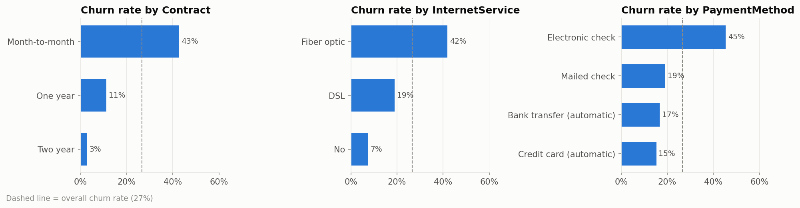
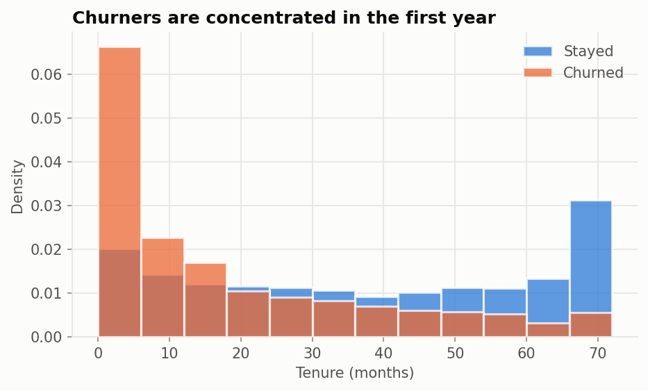
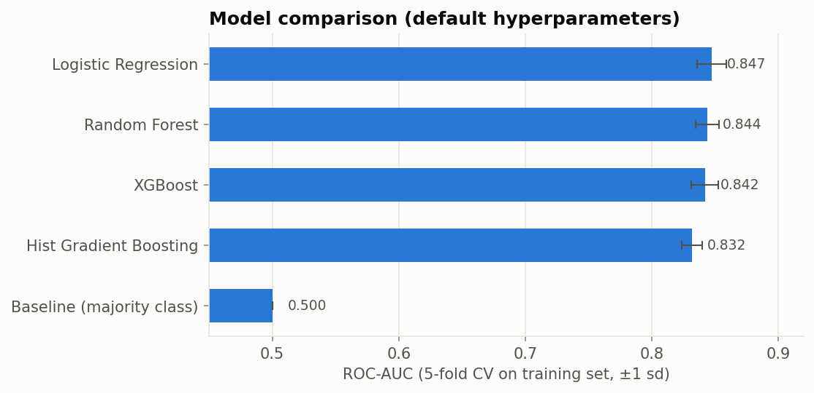
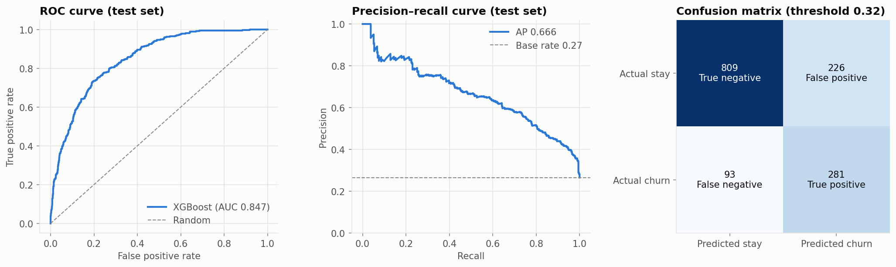
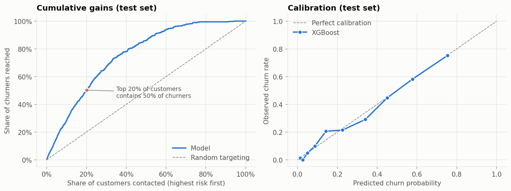
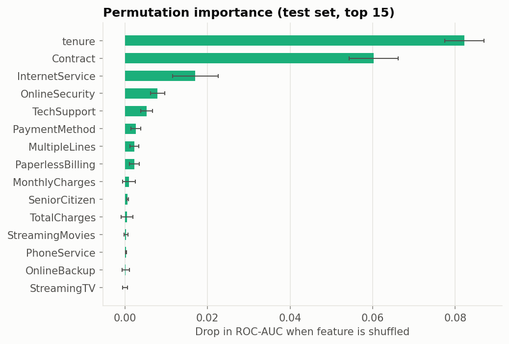
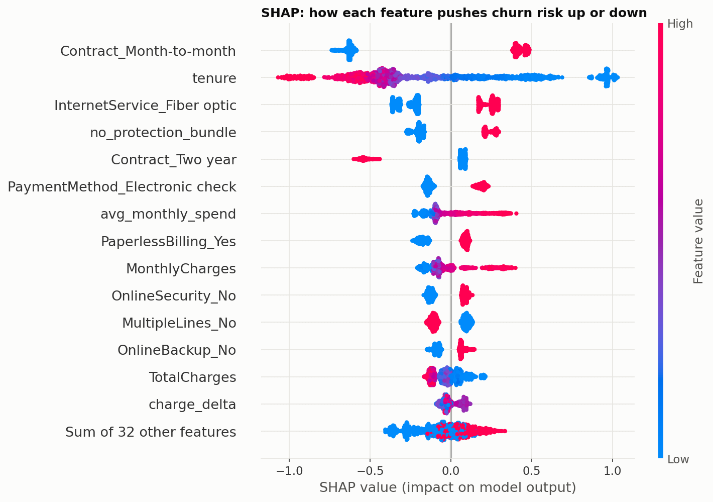

# Customer Churn Prediction


An end-to-end machine learning project that predicts which telecom customers are about to cancel
their service. It covers the whole path: verified public data, feature engineering, a fair
comparison of five models, hyperparameter tuning, threshold selection, evaluation on held-out
data, model explanation, a command-line scoring tool and automated tests.

**Result:** a tuned XGBoost model scores **ROC-AUC 0.847** on 1,409 customers it never saw during
training. Calling the **top 20% riskiest customers reaches 50% of all churners**, 2.5× better than
calling people at random.

---

## Data

**IBM Telco Customer Churn**: 7,043 customers, 20 features, 26.5% churned.
Downloaded from [IBM's official repository](https://github.com/IBM/telco-customer-churn-on-icp4d/blob/master/data/Telco-Customer-Churn.csv);
the identical file is on Kaggle as [blastchar/telco-customer-churn](https://www.kaggle.com/datasets/blastchar/telco-customer-churn).
The loader checks the file's SHA-256 on every run, so results can't silently drift if the data changes.
See [`data/README.md`](data/README.md) for the column dictionary.



Month-to-month contracts, fibre-optic internet and electronic-check payments each have churn
rates above 40%, against 27% overall. Churn is heavily concentrated in the first year:



## Method

```
raw CSV ─► clean (fix TotalCharges) ─► engineered features ─► impute / scale / one-hot ─► model
           └──────────────────── one sklearn Pipeline, saved as a single file ───────────────┘
```

1. **Split:** 80% train / 20% test, stratified on churn. The test set is touched exactly once, at the end.
2. **Features:** the pipeline adds six domain features to the raw columns: number of add-on services,
   average historical monthly spend, current-vs-historical charge gap, new-customer flag (≤ 6 months),
   automatic-payment flag, and a "has internet but no security or tech support" flag.
   Because feature engineering lives inside the pipeline, the saved model takes raw rows directly
   and there is no training/serving skew.
3. **Model comparison:** 5-fold stratified cross-validation of a majority-class baseline, Logistic
   Regression, Random Forest, Histogram Gradient Boosting and XGBoost.
4. **Tuning:** 40-iteration randomized search per model family (elastic-net logistic regression,
   forest and boosting hyperparameters); the best cross-validated ROC-AUC wins.
5. **Class imbalance:** handled by tuning the decision threshold, not by re-weighting classes,
   so the predicted probabilities stay honest (see the calibration plot). The threshold that maximises F1
   is picked from out-of-fold predictions on the training set, never from the test set.
6. **Final model:** evaluated once on the test set, then refit on all 7,043 rows for the shipped model.



| Model (after tuning) | CV ROC-AUC |
|---|---|
| **XGBoost** (selected) | **0.850** |
| Logistic Regression | 0.848 |
| Random Forest | 0.848 |
| Hist Gradient Boosting | 0.845 |
| Baseline (always "no churn") | 0.500 |

The four real models finish within 0.005 AUC of each other, which is inside the fold-to-fold
noise (±0.01). This dataset is mostly explained by a few strong signals, so a well-regularised
logistic regression is almost as good as boosted trees and is a reasonable choice if
interpretability matters more than the last fraction of a point.

## Results (held-out test set, 1,409 customers)

| Metric | Tuned threshold (0.32) | Default threshold (0.50) |
|---|---|---|
| ROC-AUC | 0.847 | 0.847 |
| PR-AUC (base rate 0.27) | 0.666 | 0.666 |
| Recall (churners caught) | **75.1%** | 51.6% |
| Precision | 55.4% | 66.3% |
| F1 | **0.638** | 0.580 |
| Accuracy | 77.4% | 80.2% |
| Brier score | 0.135 | 0.135 |
| Lift in top 10% / top 20% | 2.8× / 2.5× | |

The tuned threshold trades a little precision for catching 281 of 374 churners instead of 193. For
a retention campaign, where a missed churner usually costs more than an unneeded discount, this is
the better trade. The threshold is stored in the model file and can be changed.




## What drives churn




- **Tenure and contract type dominate.** New customers on month-to-month contracts are the highest-risk
  group; two-year contracts almost eliminate churn.
- **Fibre-optic customers churn more**, despite it being the premium product, which points to a price or
  service-quality issue worth investigating.
- **No online security or tech support** raises risk: customers without these add-ons are less "anchored".
- **Electronic-check payers churn more** than those on automatic payment.

Suggested actions: offer new month-to-month customers an incentive to move to a 1-year contract,
bundle security/tech support into fibre plans, and nudge customers towards automatic payment.

## Project structure

```
├── data/                    Telco-Customer-Churn.csv + data card
├── src/churn/
│   ├── data.py              download, checksum, clean
│   ├── features.py          feature engineering + preprocessing pipeline
│   ├── train.py             compare → tune → threshold → evaluate → save
│   ├── predict.py           score new customers (CLI + function)
│   └── plots.py             figure styling
├── models/churn_model.joblib   trained pipeline + threshold + metadata
├── reports/                 metrics.json, CV comparison, feature importance, figures/
├── tests/test_pipeline.py   data integrity, features, model sanity checks
└── .github/workflows/       runs the tests on every push
```

## Quick start

```bash
git clone <this repo> && cd <repo>
python -m venv .venv && source .venv/bin/activate      # Windows: .venv\Scripts\activate
pip install -r requirements.txt
pip install -e .

# Score customers with the included trained model
python -m churn.predict data/Telco-Customer-Churn.csv --top 10 -o predictions.csv

# Retrain from scratch (~5-10 minutes; add --quick for a 1-2 minute smoke run)
python -m churn.train

# Run the tests
pytest
```

From Python:

```python
import pandas as pd
from churn.predict import predict

customers = pd.read_csv("data/Telco-Customer-Churn.csv").head()
predict(customers)   # -> customerID, churn_probability, churn_prediction, risk_band
```

## Limitations

- One quarter of data from a single (fictional) company: there's no time dimension, so the model can't
  be validated on a later period the way a production churn model should be.
- `TotalCharges ≈ tenure × MonthlyCharges`, so some features overlap; this affects how importance is
  split between them, not the model's accuracy.
- The saved model is tied to scikit-learn 1.8.0 (pinned in `requirements.txt`). Retrain it if you
  upgrade.

## License

MIT. The dataset is an IBM sample dataset; see IBM's repository for its terms.
